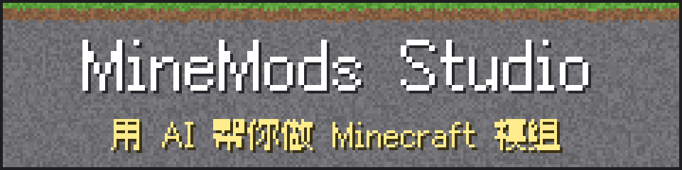
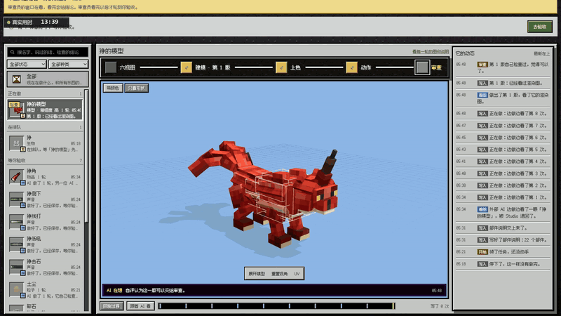
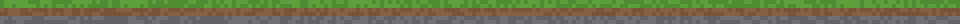
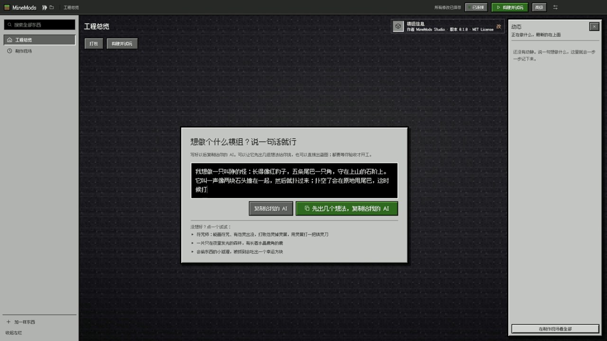
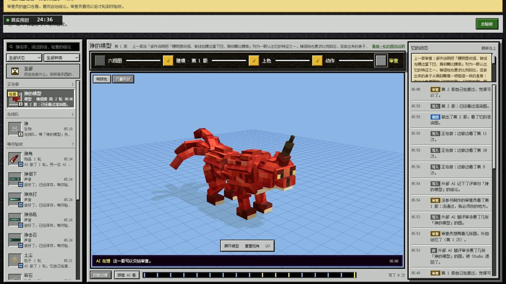
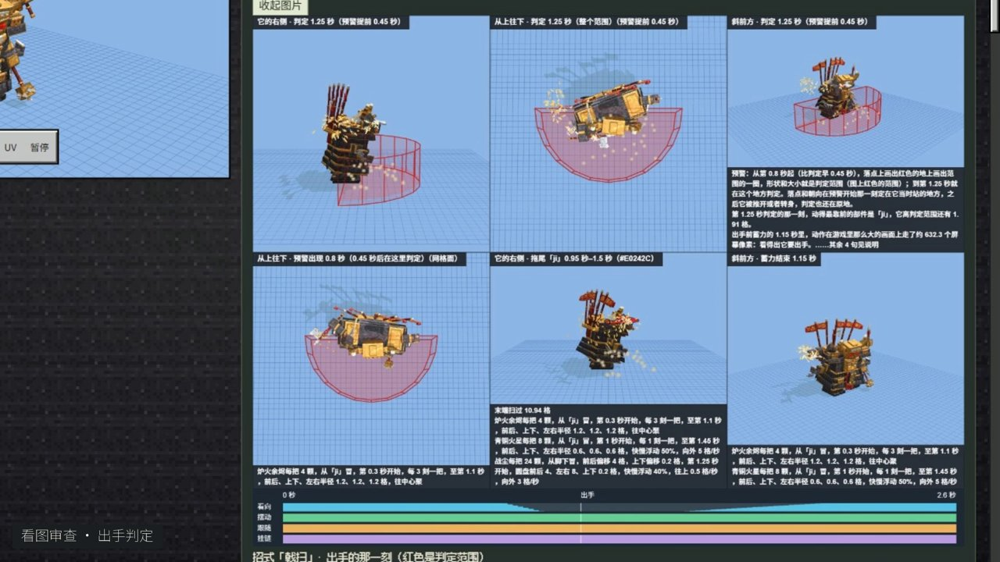
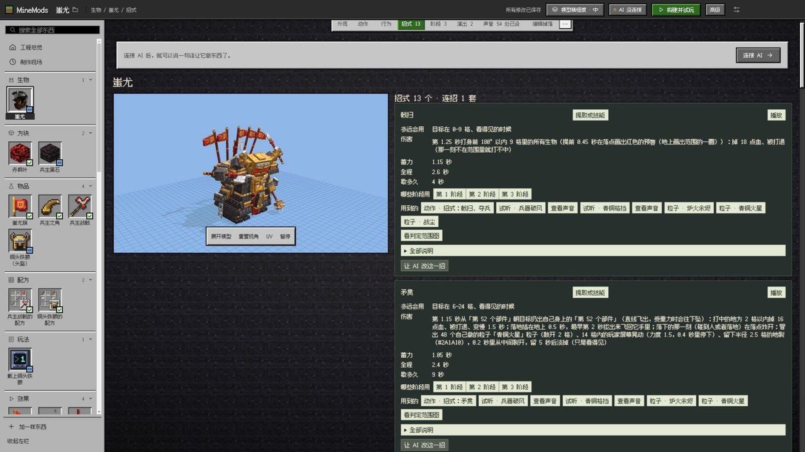
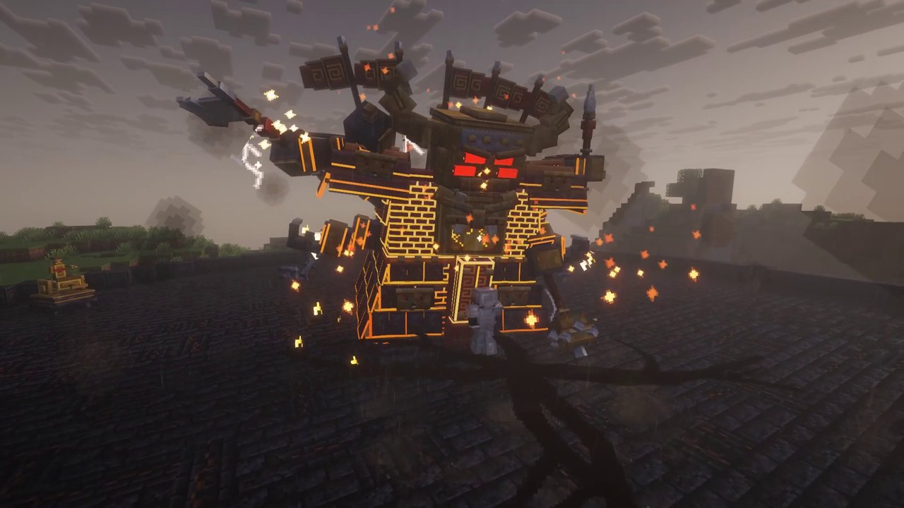
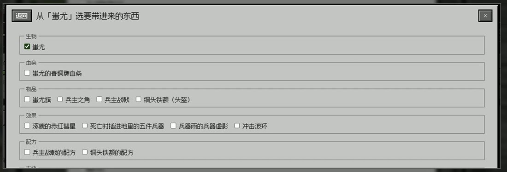
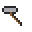

<p align="center">
  
</p>

<p align="center"><b>非官方工具，与 Mojang、微软没有任何关系。</b> · <a href="#english">English</a></p>

<p align="center"></p>

<p align="center"><sub>制作现场：AI 正在做一只生物，进度条从六视图走到建模、上色、动作、审查，右边一条条记着它做了什么。</sub></p>

<p align="center"></p>

##  这是什么

MineMods Studio 是一个**做 Minecraft 模组的桌面工具**。

它的思路是：模组里的每样东西都变成工程里一个看得见、点得开的条目，比如一只生物、一把武器、一招技能、一段背景音乐。这些条目可以让 AI 来做：你用的 AI（Claude、ChatGPT 这类）通过 MCP 接进来，按工具给的规则一样一样做。也可以你自己在表单里改。

做好以后，工具把整个工程生成成真正的 Java 模组，用 Gradle 打成 jar，再开一个测试用的游戏让你进去试。

你不用会写 Java，也不用自己配开发环境。

##  用起来是什么样

**1. 说一句话开工。** 打开工程，说你想做什么。没想好也可以让它先出几个点子。

<p align="center"></p>

**2. 看着 AI 做。** 每样东西走同一条流水线：六视图 → 建模 → 上色 → 动作 → 审查。左边是排队的任务，右边是 AI 的每一步，三维预览里随时能转着看。

<p align="center"></p>

**3. 每一招都画成图。** 技能做完，工具会从几个方向把它画出来：判定范围、出手前的预警圈、粒子从哪冒、什么时候打中。不用进游戏也能看出这招对不对。

<p align="center"></p>

**4. 哪里不满意就自己改。** 招式的蓄力、冷却、连招、用到的动作和声音都在表单里。模型用内置的 Blockbench 改。

<p align="center"></p>

**5. 构建并试玩。** 点右上角的「构建并试玩」：工具生成代码、打出 jar，放进一个单独的测试游戏里启动，和你平时玩的游戏分开。

<p align="center"></p>

<p align="center"><sub>做出来的东西在游戏里的样子（我们用它做的山海经题材模组里的一只 Boss）。</sub></p>

**还能把别的工程里的东西搬过来**，一样一样勾，要什么带什么：

<p align="center"></p>

两个工程里有同一样东西，或者名字撞了，可以贴一张**对照表**，告诉工具每样东西怎么处理。

- **表的写法**：三列，分别是源、动作（对上 / 改名）、目标。
  - 在导入窗口里可以直接粘贴、逐行编辑，或者「带出上次的对照表」。
  - 用 AI 助手的话，AI 通过 MCP 传 `mapping: [{source, action, target}]`。
- **导入前先预览**：「看看会带进来什么」分三列。
  - 对上了：沿用这边已有的那一样，不带新的。
  - 改名了：按表里的注册名更新或新建。
  - 另存了：照原来的规则处理。

  每一行都写着是谁引用了它。
- **引用跟着改**：召唤用的物品和方块、巢、配方和掉落、死亡演出、场地物件、招式和共用技能，都会跟着改过来。
- **撤销**：导入完紧接着撤销，工程清单能恢复成导入前一模一样。
- **重导**：同一个源工程再导一次，会自动带出上次的表。
- **不贴表**：和以前的导入完全一样。

##  和 Minecraft 有关的

**支持的版本和加载器**

| 加载器 | Minecraft 版本 | 用的 Java |
|---|---|---|
| Fabric | 1.21.1 | 21 |
| Forge | 1.20.1 | 17 |
| NeoForge | 1.21.1 | 21 |

同一个工程可以分别打成这三种。Java 和 Gradle 第一次用的时候工具自己去准备，不用你装。

**能生成的东西**

| 类型 | 说明 |
|---|---|
| 生物和 Boss | 实体、模型（GeckoLib 格式）、贴图、动画；Boss 的阶段、血条、出场和死亡演出 |
| 招式 | 近战、冲刺、跳扑、格挡、弹射物、范围攻击；出手前的预警圈；命中时的震屏、击退 |
| 方块和物品 | 方块的形状和外观、物品、武器、手持的样子 |
| 配方和掉落 | 合成配方、战利品表 |
| 生成 | 生物在哪些群系自然出现、Boss 的巢穴随世界一起生成 |
| 粒子、声音、音乐 | 自己的粒子、音效、Boss 战背景音乐，都是独立的资产，别的生物也能拿去用 |
| 场地和天气 | Boss 战的场地、临时地形（石刺、掩体）、战斗时的天气和天色 |
| 书 | 一本能在游戏里翻的书；游戏字体里没有的字，打包时补成像素字 |
| 镜头和手势 | 过场镜头；玩家按键播放的手势动作 |

**还能打开别人的模组看看**：给它一个现成的 jar，它把里面的生物、模型、贴图、配方、声音摆出来，像打开一个箱子。只读，不会改那个 jar。

##  怎么开始

现在只有 **Windows** 版，安装包还在准备，先从源码运行：

1. 装 [Bun](https://bun.sh)（1.3 以上）和 Git。
2. 下载源码并装依赖：
   ```powershell
   git clone https://github.com/lantiansb/MineMods.git
   cd MineMods
   bun install
   ```
3. 打开工具：
   ```powershell
   bun run dev
   ```
4. 连接 AI：点右上角的「AI 没连接」（首页中间也有一个「连接 AI」链接），打开连接向导。有两种接法：
   - **用你自己的 AI 助手（Codex 或 Claude 桌面版）**：
     1. 选「用我自己的 AI 助手来做」，点下一步，再点「接到 Codex」或「接到 Claude 桌面版」。
     2. 工具会把 MCP 配置写进那边的设置文件，原来的文件会先备份一份。如果那边已经有旧的 `minemods-studio` 配置，会被更新成新的。
     3. 完全退出 Codex 或 Claude 桌面版，再重新打开，新开一个对话。
     4. 把向导第 3 步给的「起步说明」粘贴进去。
   - **让工具直接调 AI**：填一个 OpenAI 兼容的服务地址和 Key。
5. 说一句话开工：
   - 用 AI 助手的话，这句话是在 **Codex 或 Claude 的对话里**说，不是在 Studio 里说。
   - 直接调 AI 的话，就在 Studio 里说。

   然后照上面「用起来是什么样」走。

用 AI 助手时要注意两点：
- 整个过程中 Studio 要一直开着。
- 换了 Studio 的版本或位置（比如重新克隆了一份），要回向导再点一次「接到 Codex」或「接到 Claude 桌面版」。

想自己打 Windows 包：在 `packages/studio` 里运行 `bun run package`，产物在 `packages/studio/release/win-unpacked/`。

##  还在做的

说实话，它还在早期。下面这些现在还不行，或者还不稳：
- 只有 Windows 版，没有 Mac 和 Linux；安装包还没发。
- 做出来好不好看，很大程度上看你用的 AI。AI 做的贴图和模型还需要人盯着改。
- 「手势」现在只能按键播放，还不能由技能触发；第一人称视角只有一只纯色的方块手。
- 有些生物出招前转身转得太慢，跳扑容易扑偏，正在查。
- 极少见的生僻字，打包时可能补不上像素字，工具会提醒你。
- 工程很大时（比如几十 MB），点「从别的工程导入」后要等大约 50 秒才列出可选的工程。

##  常见问题

**要会写代码吗？**
不用。Java 代码是工具生成的。会写代码的话，也可以打开生成出来的源码自己改。

**要花钱吗？**
工具本身免费、开源。AI 的费用看你用哪家：用 Claude 桌面版或 Codex，就是你在那边的订阅；自己填 API，就按那家服务的价格算。

**做出来的模组能发布吗？**
能。模组是你做的，发不发、用什么许可证你自己定（打包时可以填）。发布前也看一下 Minecraft 的使用条款。

**和 Blockbench 是什么关系？**
工具里改模型用的就是 Blockbench（离线版，原样带着它的 GPL-3.0 许可证和源码）。导出的模型也能拿回 Blockbench 里继续改。

**会联网吗？**
连 AI、第一次下载 Java 和 Gradle 时要联网。工程和做出来的模组都存在你自己的电脑上。

**AI 说「连不上 MineMods Studio」或者「现在还用不了 MineMods Studio」怎么办？**
打开 Studio，点右上角的 AI 连接状态，在里面把 AI 接上，再让 AI 重试一次就行，不用重启 AI 客户端。

##  给想改代码的人

| 目录 | 是什么 |
|---|---|
| `packages/studio` | 桌面工具本身（Electron + Solid），MCP 接口也在这里 |
| `packages/studio/vendor/blockbench` | 内置的 Blockbench 5.1.6（GPL-3.0，带源码） |
| `packages/mod-core` | 把工程变成模组：生成 Java、贴图、动画、声音，再用 Gradle 打包 |
| `packages/studio-ai` | 告诉 AI 每一类东西该怎么写的规则和格式 |
| `packages/ai-service` | 连 AI 服务商的那一层 |
| `templates/` | 四套空白模组模板（Fabric 两种、Forge、NeoForge） |
| `docs/` | 几份功能说明；`docs/specs/` 是验收标准和 Boss、飞行等规格，部分测试会读这里 |
| `tools/art/` | README 图片和材料小图标的画图脚本 |

测试和类型检查**在各个包的目录里跑**，不要在根目录跑：

```powershell
cd packages/mod-core
bun run typecheck
bun run test
```

## 许可证

MineMods Studio 自己的代码用 [MIT](LICENSE)。内置的 Blockbench 和从它改编的两个文件是 GPL-3.0，两套像素字体是 OFL，见 [THIRD_PARTY_NOTICES.md](THIRD_PARTY_NOTICES.md)。打包出来的软件里编进了这些 GPL 部分，所以软件整体按 GPL-3.0 分发，源码就是这个仓库。

Minecraft 是 Mojang Studios 的商标。本项目是非官方工具，与 Mojang、微软没有任何关系，也没有得到它们的认可。仓库里不包含 Mojang 的原版贴图。

<p align="center"></p>

## English

**MineMods Studio** is an unofficial Windows desktop tool for making Minecraft mods. Every part of a mod (a creature, a weapon, an ability, a piece of music) is an entry you can see and edit. Your AI (Claude Desktop, Codex, or any OpenAI-compatible API) connects through MCP and builds those entries step by step: six-view sketch, model, texture, animation, review. Abilities are drawn as diagrams of their hit areas, warnings and particles. Then the tool generates real Java code, builds a jar with Gradle and launches a separate test game, for Fabric 1.21.1, Forge 1.20.1 or NeoForge 1.21.1. It is early: Windows only, no installer yet, and the art quality depends heavily on the AI you use. Code is MIT; Blockbench and two files adapted from it are GPL-3.0, so the packaged app as a whole is GPL-3.0 (see `THIRD_PARTY_NOTICES.md`). Not affiliated with or endorsed by Mojang or Microsoft.
